

  

<!-- Title -->
<h3 align="center">
    <samp>
        &gt; Hey There!, I am
        <b><a target="_blank" href="https://www.linkedin.com/in/hirad-alagha/">Hirad Emamialagha</a></b>
    </samp>
</h3>

 

<samp>
「 Lead ML Engineer building scalable AI systems, MLOps platforms, and distributed ML infrastructure 」
</samp>

  
  
  

  
   
  
  <a href="./docs/pages/LABS.md">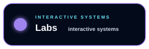</a>
  

<!-- Title -->

  

<a href="https://hirademami.github.io/">
  
</a>

<a href="https://hirademami.github.io/neural-lab/index.html">
  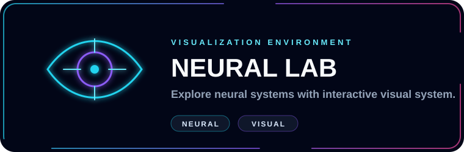
</a>
<a href="https://hirademami.github.io/molecules/index.html">
  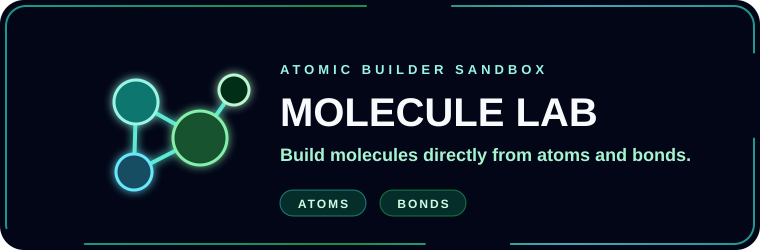
</a>
<a href="https://hirademami.github.io/model-forge/index.html">
  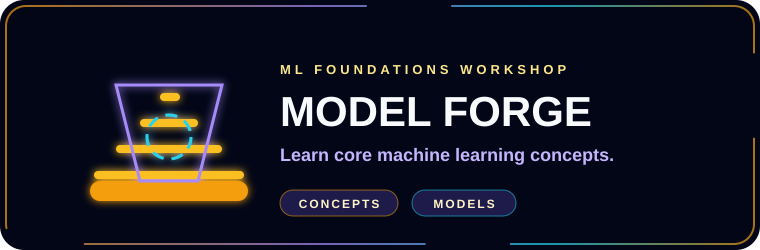
</a>

  

  
   
  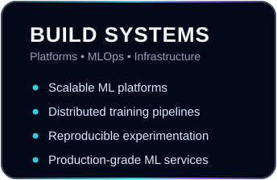
  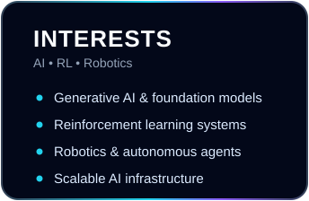
  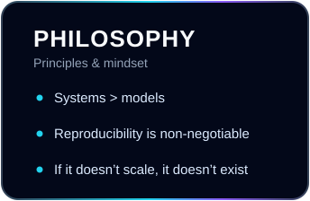

# 🛠 Technologies, Projects, and Domains

<table align="center" cellspacing="0" cellpadding="6">
  <tr>
    <td align="center"></td>
    <td align="center"></td>
    <td align="center"></td>
    <td align="center"></td>
    <td align="center"></td>
  </tr>
  <tr>
    <td align="center"></td>
    <td align="center"></td>
    <td align="center"></td>
    <td align="center"></td>
    <td align="center"></td>
  </tr>
  <tr>
    <td align="center"></td>
    <td align="center"></td>
    <td align="center"></td>
    <td align="center"></td>
    <td align="center"></td>
  </tr>
  <tr>
    <td align="center"></td>
    <td align="center"></td>
    <td align="center"></td>
    <td align="center"></td>
    <td align="center"></td>
  </tr>
  <tr>
    <td align="center"></td>
    <td align="center"></td>
    <td align="center"></td>
    <td align="center"></td>
    <td align="center"></td>
  </tr>
</table>

  <a href="docs/pages/PROJECTS.md">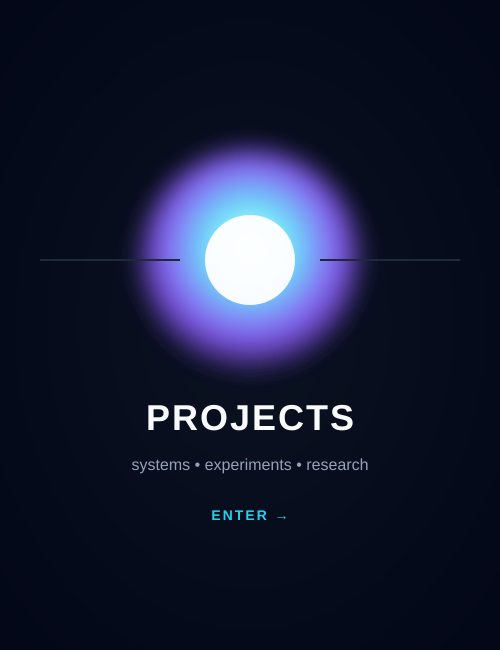</a>
  <a href="docs/pages/AI_DOMAIN.md">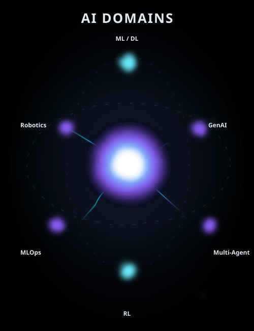</a>

### 📊 Vital Statistics

  

  

    

  

  

<h2>🤝 Collaboration</h2>

I’m open to collaborating on:

<ul>
  <li>ML infrastructure projects</li>
  <li>Reinforcement learning systems</li>
  <li>Robotics & autonomous systems</li>
  <li>Large-scale AI platforms</li>
</ul>

  <a href="docs/pages/COLLAB.md">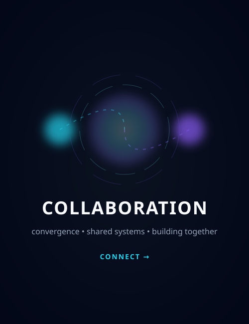</a>

<h2>📫 Contact</h2>

  
    
  
    
  

⚡ Building scalable AI systems and machine learning infrastructure

Star ⭐ the repos if they helped you!

  <a href="./.github/CODE_OF_CONDUCT.md">Code of Conduct</a> ·
  <a href="./.github/CONTRIBUTING.md">Contributing</a> ·
  <a href="./.github/SECURITY.md">Security</a> ·
  <a href="./docs/README.md">Docs</a> ·
  <a href="./docs/pages/COLLAB.md">Collaboration</a> ·
  <a href="./docs/meta/ROADMAP.md">Roadmap</a> ·
  <a href="./docs/meta/STYLE_GUIDE.md">Style Guide</a> ·
  <a href="./docs/meta/VISUAL_AUDIT.md">Visual Audit</a> ·
  <a href="./docs/meta/SHOWCASE_STRATEGY.md">Showcase Strategy</a> ·
  <a href="./docs/meta/ASSET_INDEX.md">Asset Index</a>

    

  

